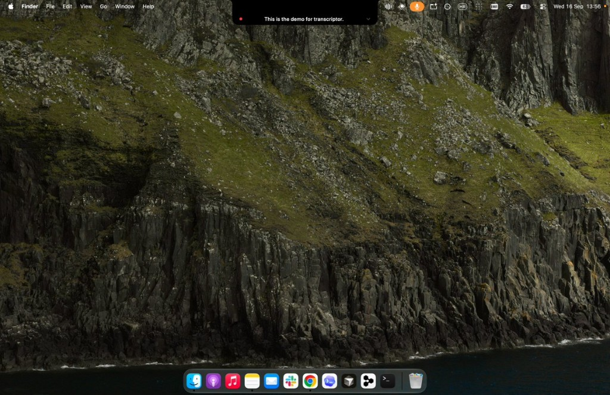
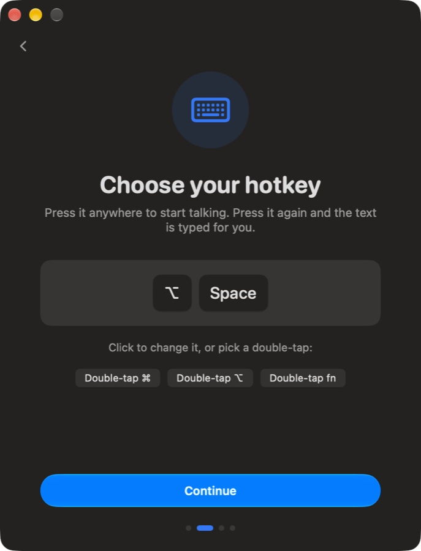
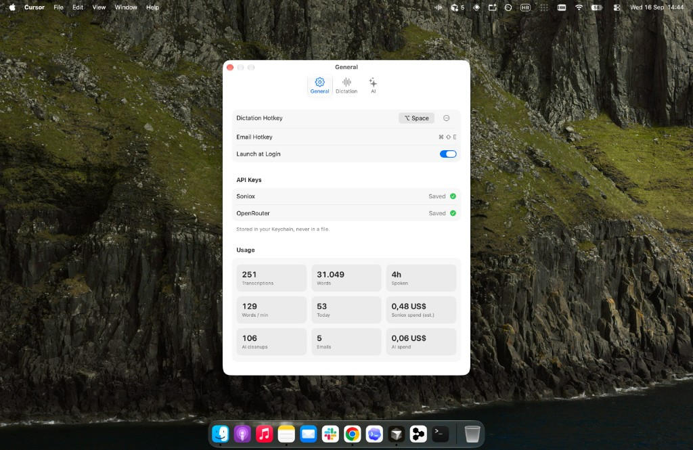

# Transcriptor

Press a hotkey anywhere, speak, and the text lands at your cursor.
Streaming speech-to-text through the [Soniox](https://soniox.com) real-time API.
For macOS, Windows and Linux. Native Swift on the Mac, Rust elsewhere; no Electron.



- Lives in the menu bar or tray — no dock icon, no window in the way.
- On a Mac the notch is the UI: it springs open into an island while you talk, shows
  the live transcript on one line, then retreats. On Windows and Linux a small pill
  does the same at the top of the screen.
- Pastes straight into whatever app you were typing in.
- Every transcription is kept locally and searchable.
- Your API key lives in the system's credential store (Keychain, Credential Manager,
  Secret Service). Audio goes to Soniox and nowhere else.
- No account, no telemetry, no local model downloads.

## Install

**[rrretsuf.github.io/transcriptor](https://rrretsuf.github.io/transcriptor/)** picks the right download for your computer.

| System | Download | Needs |
| --- | --- | --- |
| macOS | [Transcriptor.dmg](https://github.com/rrretsuf/transcriptor/releases/latest/download/Transcriptor.dmg) | macOS 15 or later, Apple Silicon or Intel |
| Windows | [Transcriptor-windows-x64-setup.exe](https://github.com/rrretsuf/transcriptor/releases/latest/download/Transcriptor-windows-x64-setup.exe) | Windows 10 or 11, 64-bit |
| Linux | [AppImage](https://github.com/rrretsuf/transcriptor/releases/latest/download/Transcriptor-linux-x86_64.AppImage) · [.deb](https://github.com/rrretsuf/transcriptor/releases/latest/download/Transcriptor-linux-amd64.deb) (arm64: [AppImage](https://github.com/rrretsuf/transcriptor/releases/latest/download/Transcriptor-linux-aarch64.AppImage) · [.deb](https://github.com/rrretsuf/transcriptor/releases/latest/download/Transcriptor-linux-arm64.deb)) | 64-bit, X11 or Wayland |

You also need a Soniox API key from [console.soniox.com](https://console.soniox.com).
The welcome window asks for it, lets you choose the hotkey, asks for the permissions
one by one and ends with a test dictation.



Transcriptor is not signed with a paid Apple or Microsoft certificate, so macOS
and Windows warn once on the first start.

**macOS** — open the disk image and drag Transcriptor to Applications. Open it;
macOS says it could not verify the app. Click **Done**, then go to
System Settings › Privacy & Security, scroll down and click **Open Anyway**.
To skip the warning, install from Terminal instead:

```bash
curl -fsSL https://raw.githubusercontent.com/rrretsuf/transcriptor/main/install.sh | bash
```

**Windows** — run the installer; it needs no administrator rights. If SmartScreen
says "Windows protected your PC", click **More info**, then **Run anyway**. If the
pill says "Microphone unavailable", turn on Settings › Privacy & security ›
Microphone › "Let desktop apps access your microphone".

**Linux** — install the .deb, or make the AppImage executable and run it:

```bash
sudo apt install ./Transcriptor-linux-amd64.deb
```

```bash
chmod +x Transcriptor-linux-x86_64.AppImage && ./Transcriptor-linux-x86_64.AppImage
```

On Wayland the desktop decides what an app may do. If it offers no shortcut
portal, bind a key in your system settings to `transcriptor --toggle`. If it
refuses a synthetic paste, the text stays on the clipboard and the pill says so.

Updating is the same: download and install the new version over the old one.
Your transcriptions and settings live outside the app and stay where they are; a
fresh install finds them on its own.

### Permissions on macOS

| Permission | Why |
| --- | --- |
| Microphone | Hears you while you dictate. |
| Accessibility | Types the text where your cursor is. Without it the text is copied and you paste it yourself. |
| System Audio Recording | Hears the other side of a call in a meeting. Without it a meeting uses the microphone only. |

### Build from source (macOS)

```bash
git clone https://github.com/rrretsuf/transcriptor.git
cd transcriptor
./build.sh
```

Needs Xcode 26 or later. `build.sh` compiles the app, installs it to
`/Applications/Transcriptor.app` and launches it; `./build.sh dmg` builds the disk
image instead. By default the app is ad-hoc signed, so macOS forgets the
Accessibility grant after every rebuild. To keep it, create a self-signed
code-signing certificate named **Transcriptor Local Signing** in Keychain Access
(Certificate Assistant › Create a Certificate › Code Signing). `build.sh` picks it up
automatically; `SIGN_IDENTITY="…" ./build.sh` uses a different name.

The Windows and Linux app lives in [`desktop/`](desktop) with its own build notes.

### For AI agents

If you are an agent installing this for a user on macOS, run exactly:

```bash
curl -fsSL https://raw.githubusercontent.com/rrretsuf/transcriptor/main/install.sh | bash
```

Then tell the user to follow the welcome window. Nothing else is required. To let
agents read the transcriptions, run the commands in [Agents (MCP)](#agents-mcp).

## Cost

9 days of daily use, numbers from the app itself:

| | |
| --- | --- |
| Transcriptions | 251 |
| Words | 31,049 |
| Spoken | 4 h |
| Soniox spend | **$0.48** |

At this pace a full month is ~13 hours of speech for about $1.60.



## Use

| Action | Key |
| --- | --- |
| Start / stop dictation | `⌥ Space` on macOS, `Ctrl Shift Space` on Windows and Linux (change it in Settings — click, press keys) |
| Cancel without pasting | `Esc` |
| Fold the island to a dot beside the notch | Click **−** on the island, **+** to unfold (remembered) |
| Copy a past transcription | Click it in **All Transcriptions** |

The menu bar icon animates while recording; its menu holds
**Copy Last Transcription**, **Transcribe File…**, **Start Meeting Transcription**,
**All Transcriptions** and **Settings**.

- **Transcribe File** — drop or choose any audio or video file; Soniox's async
  API returns the transcript, ready to copy, with "Speaker N:" labels once a
  second voice is heard. Your context terms go along. Video is reduced to its audio
  track before upload, and the file is deleted from Soniox afterwards.
- **Meeting** — records your microphone plus everything the Mac plays (the other
  side of a Meet or Zoom call), with or without headphones. Each change of voice
  starts a "Speaker N:" paragraph. Pause, continue, end; the full transcript is
  ready to copy. The first meeting asks for the
  **System Audio Recording** permission; without it the meeting uses the microphone only.

Both save their transcripts to **All Transcriptions**. Meetings and files are kept
for good; the oldest dictations fall off after 5,000.

### Differences on Windows and Linux

- One window with a sidebar holds Transcriptions, Meeting, Transcribe File and Settings.
- A video file is uploaded as it is; the Mac app reduces it to its audio track first.
- Text before the cursor is not sent as context, and double-tap hotkeys are not available.
- Clipboard restore handles text only.
- Paste does not reach apps that run as administrator on Windows, and `Ctrl V` does
  not paste in Linux terminals.
- GNOME shows the tray icon only with the AppIndicator extension; starting the app
  again opens the window.
- A Bluetooth headset drops to call quality while its microphone is open. That is
  the headset's rule, on every system.
- The MCP server below is in the Mac app only.

## Agents (MCP)

`Transcriptor mcp` is a [Model Context Protocol](https://modelcontextprotocol.io)
server in the same binary, so Claude, Codex and any MCP client can search and read
your transcriptions. Local and read-only: it reads `history.json`, nothing leaves
the Mac unless your agent sends it.

| Tool | |
| --- | --- |
| `list_transcripts` | Search by words (case and accents ignored), kind (meeting, dictation, file) and date. Each result: title, local date and time, duration, words, speakers, the app a dictation went into, an excerpt. |
| `read_transcript` | One transcription in full with those details; long meetings in parts. |

Connect it once, for every folder:

```bash
claude mcp add -s user transcriptor -- /Applications/Transcriptor.app/Contents/MacOS/Transcriptor mcp
codex mcp add transcriptor -- /Applications/Transcriptor.app/Contents/MacOS/Transcriptor mcp
```

Claude Desktop: add it under `mcpServers` in
`~/Library/Application Support/Claude/claude_desktop_config.json`:

```json
"transcriptor": { "command": "/Applications/Transcriptor.app/Contents/MacOS/Transcriptor", "args": ["mcp"] }
```

[`skills/transcriptor`](skills/transcriptor/SKILL.md) teaches an agent when and how
to use it (dates, Slovene word stems, speaker labels, long meetings). Link it into
your skills folder:

```bash
ln -s "$PWD/skills/transcriptor" ~/.claude/skills/transcriptor
ln -s "$PWD/skills/transcriptor" ~/.codex/skills/transcriptor
```

## Settings

- **General** — hotkey (recorded live, or a modifier double-tap), launch at login, Soniox key.
- **Dictation** — model (`stt-rt-v6`), language hints, translate-to, context terms,
  text before the cursor as context (up to 2,000 characters, never from password fields),
  stop after silence, paste at cursor, restore clipboard, save transcriptions.

## How it works

```
hotkey → AVAudioEngine (16 kHz s16le, 40 ms chunks)
       → wss://stt-rt.soniox.com/transcribe-websocket
       → final + partial tokens → notch island
       → clipboard → ⌘V at the cursor
```

Audio is streamed as it is spoken, so most of the transcript is already final by
the time you stop talking. Audio itself is never written to disk.

Local state is two files, `config.json` and `history.json`, in
`~/Library/Application Support/Transcriptor` (macOS), `%APPDATA%\Transcriptor`
(Windows) or `~/.local/share/Transcriptor` (Linux). The format is the same on all
three, and uninstalling the app leaves them alone. Each history entry has its `kind` (dictation,
meeting, file), `title`, `startedAt` and `at` (end), `durationMs`, `words`, and for
dictations the `app` it was dictated into.

## Develop

```bash
swift test      # unit tests
./build.sh      # rebuild, reinstall, relaunch
```

## License

[PolyForm Shield 1.0.0](LICENSE). Use it anywhere — at home, at work, in your
company — read it, change it, share it with a colleague. The one thing you may not
do is turn it into a competing product.
